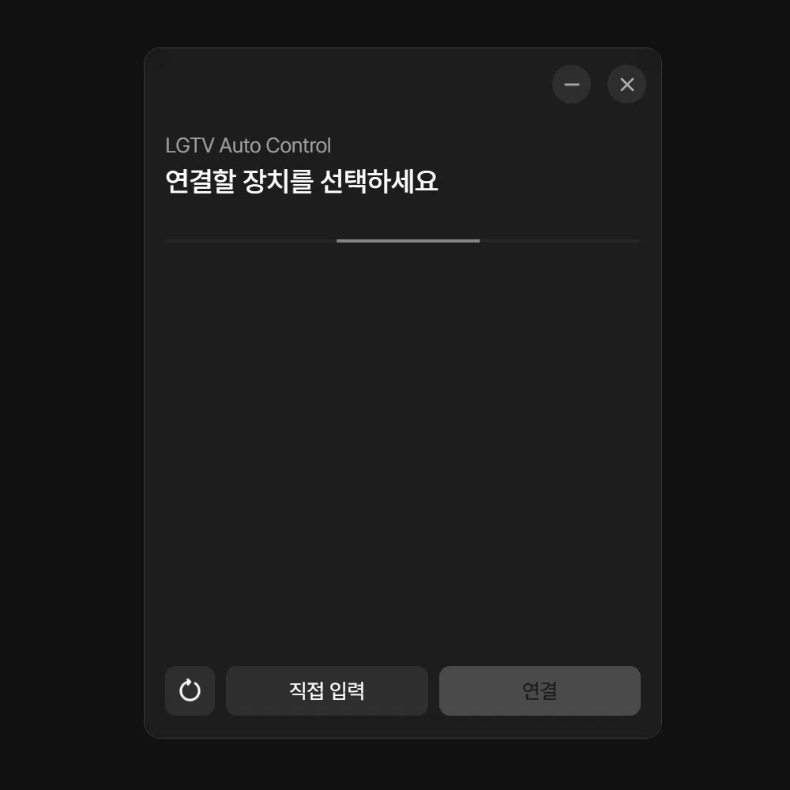

# LTAC

LG webOS TV의 전원을 PC와 함께 제어하는 Windows 앱입니다.

  

## 주요 기능

- **전원 동기화** — PC의 시작·종료, 절전·복귀, 화면 켜짐과 꺼짐에 맞춰 TV 전원을 제어합니다.
- **절전 단축키** — 지정한 단축키로 PC와 TV를 함께 절전 상태로 전환합니다.
- **여러 TV 연결** — TV를 여러 대 등록하고 전원을 함께 제어합니다.

## 시작하기

[최신 릴리스](https://github.com/mightyidler/LTAC/releases/latest)에서 **Windows x64 설치 파일**을 받아 실행하세요. 설치 시 관리자 권한이 필요합니다.

1. PC와 TV를 같은 네트워크에 연결하고 TV를 켭니다.
2. LTAC을 실행하고 검색된 TV를 선택합니다.
3. TV에 표시되는 연결 요청을 승인합니다.

TV를 자동으로 켜려면 TV 설정에서 네트워크를 통한 전원 켜기 기능을 활성화해 주세요. 설정 이름은 TV 모델에 따라 다를 수 있습니다.
