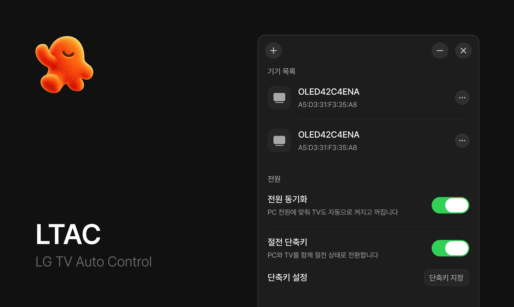

# LTAC

LG webOS TV의 전원을 PC와 함께 제어하는 Windows 앱입니다.

  

## 주요 기능

- **전원 동기화** — PC의 시작·종료, 절전·복귀, 화면 켜짐과 꺼짐에 맞춰 TV 전원을 제어합니다.
- **TV 단독 사용 시 전원 유지** — 기본값은 OFF입니다. 켜면 PC가 종료·절전하거나 화면을 꺼도, 넷플릭스나 다른 HDMI 입력을 사용하는 TV는 끄지 않습니다.
- **절전 단축키** — 지정한 단축키로 PC와 TV를 함께 절전 상태로 전환합니다.
- **여러 TV 연결** — TV를 여러 대 등록하고 전원을 함께 제어합니다.

## 시작하기

[최신 릴리스](https://github.com/mightyidler/LTAC/releases/latest)에서 **Windows x64 설치 파일**을 받아 실행하세요. 설치 시 관리자 권한이 필요합니다.

1. PC와 TV를 같은 네트워크에 연결하고 TV를 켭니다.
2. LTAC을 실행하고 검색된 TV를 선택합니다.
3. TV에 표시되는 연결 요청을 승인합니다.

TV를 자동으로 켜려면 TV 설정에서 네트워크를 통한 전원 켜기 기능을 활성화해 주세요. 설정 이름은 TV 모델에 따라 다를 수 있습니다.

‘TV 단독 사용 시 전원 유지’는 등록 시 활성 LG 디스플레이의 EDID 직접 HDMI 물리 주소(예: `3.0.0.0` → HDMI 3)를 한 번 읽어 저장합니다. PC의 OFF 이벤트에서는 저장한 번호와 TV의 현재 앱만 비교합니다. PC HDMI에서만 TV를 끄고, 다른 HDMI·Netflix·YouTube를 사용 중이거나 조회가 실패하면 TV를 켜둡니다. 조회 오류는 짧게 한 번만 재시도합니다. 사용자가 지정한 HDMI는 유지하며 자동값은 실제 디스플레이 연결 구성 변경 때만 갱신합니다.

EDID가 없거나 직접 주소가 아닌 연결, 여러 LG 디스플레이 또는 여러 등록 TV에서는 자동 설정을 보장하지 않습니다. 이때 기기 목록에서 PC가 연결된 HDMI를 직접 선택하세요.

소스 빌드와 검증 방법은 [개발 안내](docs/DEVELOPMENT.md)를 참고하세요.
